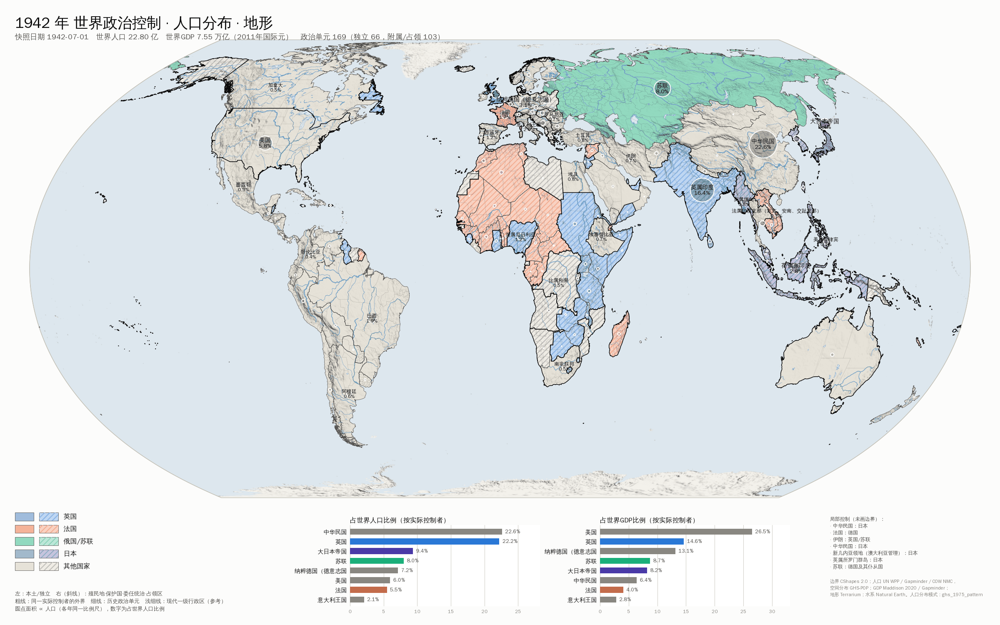

# World Map History · 世界历史地图数据

为“动态世界地图”收集整理的历史数据，分两部分：

| 部分 | 内容 | 说明 |
|---|---|---|
| **1900–2000 逐年世界数据** | 每年的实际控制政治地图、政治单元、人口与 GDP（总量和占比）、0.5° 人口网格、地形与河流，每年一张地图 | [docs/world-1900-2000.md](docs/world-1900-2000.md) |
| **1939–1945 历史省级区划与战局** | 六个断面上当日施行的省级区划（只用当时的区划，不用现代政区代替；被国界或战线穿过的省份按界线切开）、实际控制者、阵营、估计人口、重要城市；六张可交互地图，分阵营视图和各国控制区视图 | [ww2/README.md](ww2/README.md) |
| **1900–1934 七个断面** | 同样的省级区划、实际控制、阵营与城市：1900 年八国联军攻入北京、1914 年一战爆发、1915 年意大利参战、1916 年罗马尼亚参战、1917 年美国参战、1918 年停战、1934 年长征开始 | [ww2/README.md](ww2/README.md#19001934-年的七个断面) |
| **1946–1991 六个断面** | 同样的省级区划、实际控制、冷战阵营与城市：1946 年国共内战全面爆发、1947 年印巴分治、1948 年辽沈战役开始、1949 年中华人民共和国成立、1953 年朝鲜停战、1991 年苏联解体 | [ww2/README.md](ww2/README.md#19461991-年的六个断面) |
| **2026 年当今世界** | 同一张地图的第七个标签页：当今的一级行政区、法理与实际控制、军事同盟、2025–26 年人口、首都与重要工业城市和港口 | [ww2/README.md](ww2/README.md#2026-年地图) |
| **文明时代 demo（游戏）** | 仿《文明时代 2》的回合制大战略：任选一个断面和国家，从当日的省级区划、实际控制、人口与战争出发，逐月征税、招募、调兵、外交与征战；电脑国家自行扩张与议和 | [game/](#2-文明时代-demo游戏) |
| **1942 年东线态势图（OKH “Lage Ost”）** | 德国陆军总司令部作战处 1942 年每月 1 日的东线态势图原件扫描（北、南两张），来自俄罗斯国防部中央档案馆第 500 号全宗、germandocsinrussia.org 数字化项目。网站条款只允许研究用途，扫描件不放入仓库，用 `python3 scripts/okh_lage_ost.py` 下载拼接到 `okh_lage_ost_1942/` | [scripts/okh_lage_ost.py](scripts/okh_lage_ost.py) |



## 打开方式

先把仓库下载到本地：

```sh
git clone https://github.com/dns0129/World_Map_History.git
cd World_Map_History
```

数据库、地图数据、逐年导出和逐年地图（约 810 MB）不在 git 中，而是作为 [GitHub Release](https://github.com/dns0129/World_Map_History/releases) 的附件发布，版本和每个文件的 sha256 记在 `data_release.json`。克隆后先下载：

```sh
python3 scripts/data_release.py fetch     # 全部（约 460 MB 压缩包）；只要地图：fetch ww2-maps-data.tar.gz
```

网页分成两部分：**查看历史地图**（`ww2/maps/`）和**游玩文明时代 demo**（`game/`），首页 `index.html` 是两者的入口。两者都需要从本地网页服务器打开（直接双击 HTML 文件时，浏览器会拦截数据文件的读取）。在仓库根目录任选一条命令启动服务器：

```sh
python3 -m http.server 8000          # macOS / Linux
py -m http.server 8000               # Windows
npx --yes http-server -p 8000        # 已安装 Node.js 时也可以用这个
```

然后在浏览器中打开 http://localhost:8000/ （首页），停止服务器：在终端按 `Ctrl + C`。

### 1. 交互地图（1900–1991 十九个断面与 2026 年）

| 地址 | 内容 |
|---|---|
| http://localhost:8000/ww2/maps/ | 默认 1942-11-01，页面上方可切换各个断面 |
| http://localhost:8000/ww2/maps/1900-08-14.html | 八国联军攻入北京 |
| http://localhost:8000/ww2/maps/1914-08-04.html | 英国对德宣战，一战全面爆发 |
| http://localhost:8000/ww2/maps/1915-05-23.html | 意大利对奥匈宣战，加入协约国 |
| http://localhost:8000/ww2/maps/1916-08-27.html | 罗马尼亚对奥匈宣战，加入协约国 |
| http://localhost:8000/ww2/maps/1917-04-06.html | 美国对德国宣战 |
| http://localhost:8000/ww2/maps/1918-11-11.html | 贡比涅停战协定生效，一战结束 |
| http://localhost:8000/ww2/maps/1934-10-16.html | 中央红军开始长征 |
| http://localhost:8000/ww2/maps/1937-07-07.html … 1939-03-27.html | 中日战争六个关键日：卢沟桥事变、上海与太原失守、南京沦陷、徐州失守、武汉与广州失守后、南昌失守（见 [说明](ww2/README.md#19371939-年中日战争关键日)） |
| http://localhost:8000/ww2/maps/1939-09-01.html | 德国入侵波兰 |
| http://localhost:8000/ww2/maps/1940-07-01.html | 法国停战后 |
| http://localhost:8000/ww2/maps/1941-12-07.html | 珍珠港事件当日 |
| http://localhost:8000/ww2/maps/1942-11-01.html | 轴心国最大范围 |
| http://localhost:8000/ww2/maps/1941-06-22.html … 1941-12-01.html | 1941 年 6–12 月断面（苏德战争开始与每月 1 日，见 [说明](ww2/README.md#1941-年-612-月断面)） |
| http://localhost:8000/ww2/maps/1942-01-01.html … 1942-12-01.html | 1942 年逐月断面（每月 1 日，见 [说明](ww2/README.md#1942-年逐月断面)） |
| http://localhost:8000/ww2/maps/1943-01-01.html … 1944-12-01.html | 1943、1944 年逐月断面（见 [说明](ww2/README.md#19431944-年逐月断面)） |
| http://localhost:8000/ww2/maps/1945-01-01.html … 1945-05-01.html | 1945 年 1–5 月逐月断面（见 [说明](ww2/README.md#1945-年-15-月断面)） |
| http://localhost:8000/ww2/maps/1944-06-06.html | 诺曼底登陆日 |
| http://localhost:8000/ww2/maps/1945-09-02.html | 日本签署投降书 |
| http://localhost:8000/ww2/maps/1946-06-26.html | 国民政府军进攻中原解放区，国共内战全面爆发 |
| http://localhost:8000/ww2/maps/1947-08-15.html | 印度、巴基斯坦分治独立 |
| http://localhost:8000/ww2/maps/1948-09-12.html | 辽沈战役开始；朝鲜半岛南北两个政府成立 |
| http://localhost:8000/ww2/maps/1949-10-01.html | 中华人民共和国成立 |
| http://localhost:8000/ww2/maps/1953-07-27.html | 朝鲜停战协定签署 |
| http://localhost:8000/ww2/maps/1991-12-26.html | 苏联解体 |
| http://localhost:8000/ww2/maps/2026.html | 2026 年当今世界 |
| http://localhost:8000/ww2/maps/#1944-06-06/control | 任一页面后加 `#日期`，可直接跳到该断面；再加 `/nation` 或 `/control` 直接打开国家或控制国视图 |

地图功能：

- **视图：**
  - **阵营：** 按同盟国 / 轴心国 / 中立 / 前线着色，粗线为当日的法理国界和殖民地界。
  - **国家：** 每个国家按自己的法理领土着一种颜色，不计占领（1942 年的法国、波兰仍按原国界着色）；殖民地、保护国、委任统治地用宗主国颜色的浅色。
  - **控制国：** 各国的实际控制区，每个国家一种颜色，同一国家控制的地方连成一片。占领区算作占领国，例如 1942 年从法国北部到乌克兰都是“德国”；满洲国、蒙疆、维希法国、意大利社会共和国等傀儡政权单列。
  - 另有人口密度、区划资料两种着色。
- **底图：** 可在“地形”和“白色”之间切换。地形底图为分层设色加山体晕渲（低地浅绿、高原土黄、高山赭褐），白色底图为白底浅色的政区图；两种底图上山体阴影都叠在政区颜色之上。
- **地名：** 国名用小号宋体，固定在每块领土内部最中间的位置，只在名字放得进领土时显示，拖动、缩放时不会漂移。省名、河名同样由地图直接绘制，河名沿河书写。
- **点击层级：** 第一次点击选中国家（控制国视图为实际控制国，其他视图为法理上的国家 / 殖民地），面板显示人口、面积、所辖地区和主要省份；在该国范围内再点一次进入省级，显示省的历史资料和各块的实际控制者。面板顶部可从省返回国家。
- **省份与边界：** 只显示省级区划，当时的县、地区都并入所属的省。国界或战线穿过一个省时，省被切成几块，各块分别归属。
- **重要城市：** 标出首都（★，按当日的政府驻地，例如 1942 年的重庆、维希、新京，1944 年的萨勒诺和萨洛）、殖民地首府与临时政府驻地（◉）、重要港口（⚓）和工业城市（⚙）。鼠标停在城市上显示它当日的地位和简介。
- **1946–1991 年：** 阵营视图按冷战阵营着色（1946–48 年为西方盟国与苏联势力范围，1949、1953 年为北约及美国的盟友与苏联阵营，1991 年为北约与独联体）。国共内战各阶段的双方控制区、朝鲜三八线、德奥占领区、印巴分治与未加入的土邦、印度支那和印度尼西亚的战争、1991 年南斯拉夫和苏联解体中的各方，都按县或整区近似（斜线）。首都随断面变化，例如中华民国的南京、广州、台北，西德的波恩，朝鲜战争中韩国的临时首都釜山。
- **2026 年：** 当今世界的一级行政区，可同样切换阵营（北约 / 集体安全条约组织）、国家（国际普遍承认的领土）和控制国（实际控制）视图，并标出各国首都和当今的主要工业城市、港口。
- **河流：** Natural Earth 1:1000 万河流湖泊，加粗、加深颜色；放大后加入欧洲、北美的细部水系。湖泊用 1939–45 年的样子（不含战后修的水库，咸海、乍得湖用 1960 年代以前的轮廓）。
- **查找：** 按中外文名称查找省份（如“京畿道”“Seine”“Kursk”）。
- **图层开关：** 省界、国界 / 控制线、山体晕渲、河流湖泊、地名、近似斜线、重要城市。
- **游戏入口：** 页面左上角“以此断面游玩文明时代 demo”从当前断面开始游戏。

### 2. 文明时代 demo（游戏）

http://localhost:8000/game/ （或 `game/#1939-09-01` 直接选中某个断面）。仿《文明时代 2》（Age of Civilizations II）的回合制大战略，独立于地图页面，但用同一套地图数据和规则：

- **剧本：** 任选一个断面（七十多个日期，1900–1991 与 2026 年），再在列表或地图上选一个国家。每个省份就是该断面的一块省级区划（被国界或战线切开的省份按块计），开局的实际控制者、法理归属、人口、首都都取自当日的数据；被占领的省份以法理上的国家为“核心”。
- **开局的战争与同盟：** 同一阵营的国家互为同盟；战争年代（1900 年、1914–1917 年、1937 年 7 月–1945 年 5 月）对立阵营互相交战，但珍珠港事件以前中日战争与欧洲战争分开，日苏中立条约维持到 1945 年 8 月；另有长征、国共内战、印尼独立战争、印度支那战争、2026 年俄乌战争。“交战区”不属于任何国家，谁都可以进入占领。
- **经济：** 一回合为一个月。省份税收 = 人口 × 人均 GDP（`game/economy.json`，由 `scripts/game_economy.py` 从 1900–2000 逐年数据库导出；2026 年沿用 2000 年）× 0.1 / 10 亿，工业城市、港口另有加成；占领区只得一半。可投资经济（每级 +25%）、建要塞（每级防御 +30%）、研究科技（每级战力 +10%）。每个师每回合维持费 0.15 金。
- **军队：** 一个单位为一个师，开局兵力按各国 GDP 与人口估算，战时全额、平时 35%。人力每回合按核心人口补充，招募一个师 3 金、1 人力。选中本国有驻军的省份后右键点击目标：本国省份即调动（每回合走两省，跨回合的长途行军会自动继续），相邻敌省即进攻。邻接关系在浏览器中由省份轮廓算出：陆上相邻、隔海峡相望（海面上 2° 以内）、港口之间的海路（55° 以内，每回合运力 2 + 收入的十分之一个师）。
- **战斗：** 进攻力 = 师数 × 战力（人均 GDP 相对世界平均的 0.4 次方，再乘科技加成），防守力另乘 1.25 与要塞加成，海峡进攻打七折、海路登陆打五折。攻占后守军余部退往相邻的本国省份。首都失守则迁都；若此时只剩开局四分之一以下的人口，该国投降，余下领土归攻占首都者。
- **外交：** 宣战（对方盟友自动参战）、求和（按现有控制区划界，之后停战 12 回合；对方战况越不利越愿意议和，开局即在进行的战争更难结束）、结盟、解除同盟、改善关系。电脑国家会议和、结盟，也会偶尔进攻弱小的邻国（开局可选温和 / 正常 / 好战）。
- **胜负：** 控制世界一半人口获胜，国家灭亡则失败。每回合自动存档在本机浏览器（localStorage）。

规则、电脑和棋盘的代码是不依赖页面的 JavaScript 模块（`game/rules.js`、`game/ai.js`、`game/geometry.js`、`game/data.js`），`node --test tests/game/game.test.js` 可以在 Node 中测试，取得地图数据后还会用 1942-11-01 的真实断面让电脑各国打满一年。

### 3. 数据库（SQLite）

| 文件 | 内容 |
|---|---|
| `db/ww2_divisions_1939_1945.sqlite` | 1939–1945 六个事件日的历史省级区划与实际控制（27 MB） |
| `db/ww2_china_1937_1939.sqlite` | 1937–1939 中日战争六个关键日（表结构相同） |
| `db/ww2_monthly_1941.sqlite` … `ww2_monthly_1945.sqlite` | 1941–1944 年逐月断面与 1945 年 1–5 月断面，每年一个文件（31–40 MB，表结构相同） |
| `db/divisions_1900_1934.sqlite` | 1900–1934 四个事件日（表结构相同） |
| `db/divisions_1915_1917.sqlite` | 1915–1917 三个一战事件日（表结构相同） |
| `db/divisions_1946_1991.sqlite` | 1946–1991 六个断面（表结构相同） |
| `db/world_history_1900_2000.sqlite` | 1900–2000 逐年世界数据 |

每个文件都是完整的：表、视图（`snapshot_full`）、索引相同，并带有它的断面用到的全部区划、切块、控制方、规则和来源，单独打开即可查询，不需要同时打开其他文件。逐月文件中的区划多为事件日数据库里的同一批历史省份（复制了一份），`meta` 表的 `base_database` 写明它们来自哪个事件日。

几何存为 GeoJSON 文本，不需要 GIS 扩展。可以用命令行、Python 或图形界面打开：

```sh
sqlite3 db/ww2_divisions_1939_1945.sqlite
sqlite> .tables
sqlite> SELECT snapshot, bloc, SUM(population_est) FROM snapshot_full GROUP BY snapshot, bloc;
```

```python
import sqlite3, pandas as pd
con = sqlite3.connect("db/ww2_monthly_1943.sqlite")
df = pd.read_sql("SELECT * FROM snapshot_full WHERE snapshot = '1943-07-01'", con)
```

需要跨文件查询时（例如 1939–1945 全部断面的阵营人口），用 `ATTACH` 把几个文件挂在一起，再 `UNION ALL`：

```sql
ATTACH 'db/ww2_monthly_1943.sqlite' AS m43;
ATTACH 'db/ww2_monthly_1944.sqlite' AS m44;
SELECT snapshot, bloc, SUM(population_est) FROM (
  SELECT snapshot, bloc, population_est FROM main.snapshot_full
  UNION ALL SELECT snapshot, bloc, population_est FROM m43.snapshot_full
  UNION ALL SELECT snapshot, bloc, population_est FROM m44.snapshot_full)
GROUP BY snapshot, bloc ORDER BY snapshot;
```

图形界面可用 [DB Browser for SQLite](https://sqlitebrowser.org/)（免费）：打开文件后在 “Browse Data” 中选表或视图。

### 4. 逐年地图与导出文件（1900–2000）

```
maps/<年份>.png                 每年一张预览地图，直接用图片查看器打开
exports/years/<年份>.json       每年一份、结构一致的数据，供前端导入
exports/geometry/units.topojson 全部历史政治单元边界
```

### 5. 在线访问（可选）

- **GitHub Pages：** 在仓库的 Settings → Pages 中，把 Source 设为 “GitHub Actions”。之后每次推送到 `main`，`.github/workflows/pages.yml` 会下载 `data_release.json` 所指的地图数据并部署：首页 https://dns0129.github.io/World_Map_History/ ，地图在 `ww2/maps/`，游戏在 `game/`（首页带 `#日期` 的旧链接，如 `…/World_Map_History/#1944-06-06`，仍转到地图）。
- **Claude Artifact：** 本仓库构建时另发布了一份私有链接（https://claude.ai/artifact/3s4bb36QVmiUUhQAaxUnXf）。只有所有者和被分享的人能打开。更新时用 `scripts/publish_artifact.py` 只上传变了的文件（见 [SOP](docs/snapshot-sop.md#发布到-claude-artifact)）。

## 目录

```
README.md                  本文件
docs/world-1900-2000.md    1900–2000 部分的说明（方法、表结构、核对结果、局限）
docs/snapshot-sop.md       新增断面的生产 SOP（规则、录入卡片、文件清单、流程）
ww2/README.md              1900–1991 各断面的说明（区划来源、省级合并、覆盖程度、控制判定、表结构）
index.html                 首页：查看历史地图 / 游玩文明时代 demo
ww2/maps/                  交互地图（index.html、每个断面一页、data/、vendor/）
game/                      文明时代 demo（index.html、main.js 页面；rules.js 规则；ai.js 电脑；geometry.js 棋盘；data.js 读地图数据；economy.json 人均 GDP）
ww2/coverage*.csv          各层级、各政治单元的省级区划覆盖程度（*_1900_1934 为早期七个断面，*_1946_1991 为战后六个断面）
db/                        SQLite 数据库（事件日、逐月断面、逐年数据各自成文件）
exports/                   1900–2000 逐年导出文件
maps/                      1900–2000 逐年地图
curated/                   人工整理的控制事件、控制规则、名称对照
okh_lage_ost_1942/         1942 年每月 1 日的 OKH 东线态势图扫描（scripts/okh_lage_ost.py 下载拼接，不提交）
scripts/                   全部构建脚本
tests/                     单元测试（python3 -m unittest discover tests；游戏的测试在 tests/game/，需要 Node.js）
build_all.sh               一键重建
checks.json                1900–2000 数据库的核对结果
```

## 重建

所有数据都可以从原始来源重新生成。原始下载放在 `raw/`，中间文件放在 `work/`，这两个目录不提交。

```sh
pip install -r requirements.txt
./build_all.sh
```

**版本锁定：** `requirements.txt` 写明各 Python 库的版本；`sources.json` 写明每个数据源的版本（git 仓库的提交、OpenHistoricalMap 的 planet 文件），下载脚本按它取数据，不取“最新”，所以重建读到的数据与上次构建相同。`build_all.sh` 下载后运行 `python3 scripts/sources.py --check`，按校验值核对 `raw/` 的各个文件夹，不一致就停下。要更新某个数据源：改 `sources.json` 中它的提交或文件，重新下载，再运行 `python3 scripts/sources.py --record`。

首次全流程约 2 小时，需要下载约 4 GB：

- 1900–2000 部分约 30 分钟；
- 1900–1991 部分需要 OpenHistoricalMap 全球数据约 1.3 GB。三个时期、2026 年图层、网页地图和追加的断面（目前为 1915–1917 年三个）共 68 个任务，由 `scripts/pipeline.py` 调度，首次构建约 80 分钟（16 GB 内存的机器上）。

`pipeline.py` 为每个任务记下输入的指纹，再次运行时只重算输入变了的部分：

- 没有改动时约 3 秒（全部跳过）；
- 改一个时期的控制规则约 6 分钟（只重算该时期各日期的快照和数据库，结果没变的下游任务也跳过）；
- 构建被中断（容器重启、进程被杀）后，再运行 `python3 scripts/pipeline.py` 从断点继续。

下载来源都在 GitHub 和 AWS S3 上，只有 1897 年俄国省界来自 heidata.uni-heidelberg.de；在受限网络中构建时，需要把这个域名加入允许列表。

各步骤见 `build_all.sh` 和 `scripts/pipeline.py` 开头的说明。

程序的分层、两条构建路径共用的控制规则和单元测试（`python3 -m unittest discover tests`）见 [程序结构](docs/architecture.md)。

按历史地图描出的资料（`curated/` 中的战线、根据地、1945 年图集）怎样从原图复现，见 [描图资料的来源与复现](docs/tracing.md)：自动描出的部分由 `scripts/trace/` 的脚本从原图重新生成（`--check` 与仓库逐字节比较），目视读出的部分以读数为原始资料。

仅重建 1915、1916、1917 三个交互断面（以及 `scripts/added_dates.py` 中以后追加的其他日期）时，可以直接使用仓库内已有的数据库和地图数据，无需下载原始资料：

```sh
pip install -r requirements.txt
python3 scripts/add_snapshots.py
python3 scripts/ww2_html.py
```

新增断面的规则和流程见 [docs/snapshot-sop.md](docs/snapshot-sop.md)。1915–1917 三个断面写入原有的 `db/divisions_1900_1934.sqlite`，复用原地图的界面、数据格式、地形和水系。省级人口沿用既有历史区划的空间分布，缩放到同一逐年数据库的人口估计；前线和部分占领区为明确标注的近似，详见 [一战断面说明](ww2/README.md#19151917-三个一战事件日)。

## 来源与许可

- **CShapes 2.0、中研院台湾历史图层：** CC BY-NC-SA 4.0，非商业。因此整个数据集只可用于非商业用途。
- **OpenHistoricalMap、Newberry 美国县界史、Natural Earth、K. Lawson 东亚图层：** CC0 或公有领域。
- **地形：** Mapzen / AWS Terrarium 高程瓦片（SRTM、GMTED2010、ETOPO1 等，见其说明）；地图文字字形取自 OpenMapTiles 字库的 Noto Sans（SIL OFL）。
- **GHS-POP、geoBoundaries：** CC BY 4.0（2026 年人口用 GHS-POP 2025）。
- **1897 年俄国省界（Sablin 等，Transcultural Empire GIS，heiDATA doi:10.11588/data/10064）：** CC BY 4.0，用于 1900–1918 年的俄国与芬兰各省。
- **人口与 GDP 序列：** 联合国 WPP、Gapminder、Maddison Project，许可见各自来源。

完整引用写在两个数据库的 `sources` 表中。本仓库的代码与 `curated/` 整理表为 CC0。
